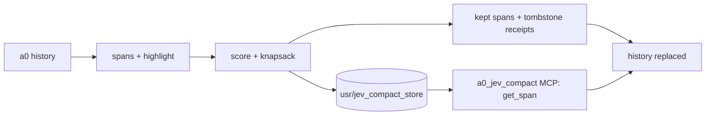

<p align="center">
  <picture>
    <source media="(prefers-color-scheme: dark)" srcset="assets/brand/wordmark-dark.svg">
    
  </picture>
</p>

Span-scored context compaction for [Agent Zero](https://github.com/agent0ai/agent-zero): keep the spans that matter, tombstone the rest, and restore any tombstone verbatim through a bundled MCP server.

Status: v0.1.0, off by default (`enabled: false`), min a0 0.9. Tests: `tests/` (CI runs `pytest tests/`). Engine: the vendored, stdlib-only [`jev-compact`](https://github.com/duketopceo/jev-compact). Roadmap: [ROADMAP.md](ROADMAP.md).

<!-- TODO: screenshot of the settings panel from a running a0 -->
There is no custom UI; a0 renders the settings panel from `default_config.yaml`.

## Install

Place this repository at `<a0>/usr/plugins/jev_compact/` (the folder name must match `name: jev_compact` in `plugin.yaml`), then restart a0. Requires Python 3 and no extra packages.

## Quick start

1. In the plugin settings set `enabled: true`. At startup the plugin registers the `a0_jev_compact` MCP server (unless `auto_register_mcp: false`).
2. Optional: add `TYPESAFE_API_KEY` or `OPENROUTER_API_KEY` to env, `usr/secrets.env` or `usr/.env` for model scoring. Without a key the offline heuristic scorer is used.
3. Compact a chat: `POST /api/plugins/jev_compact/compact` with `{"context": "<ctxid>", "action": "compact"}` (use `"stats"` to preview), or let the agent call the `jev_compact` tool.
4. Restore with the MCP tools, for example `get_span("s4-s9")`.

## How it works



## How it differs from stock `_chat_compaction`

| | `_chat_compaction` (upstream) | `jev_compact` (this plugin) |
|---|---|---|
| Unit of retention | whole chat → one LLM summary | per-**span** keep/tombstone decision |
| Loss model | lossy rewrite, original only in a backup file | non-destructive — dropped spans are *tombstoned with receipts* and restore verbatim |
| Scoring | none (summarize everything) | `(relevance, load_bearing)` vs the moving work-highlight — heuristic offline or TypeSafe Jev / OpenRouter Decisions |
| Agent self-service | manual button only | `jev_compact` tool (deferred to loop end) + `a0_jev_compact` MCP restore tools |
| Tail | summarized with the rest | `tail_keep` trailing spans never scored out |

Upstream's *automatic* attention-window `compress()` (`message_loop_end/_10_organize_history`) still runs — this plugin does not intercept it. Span compaction is invoked: via API, via the agent tool, or manually in the MCP client's UI.

## Tools registered

**API** (POST, authed):
- `/api/plugins/jev_compact/compact` — `{context, action: "stats"|"compact"}`; mirrors `_chat_compaction`'s contract (refuses while running, below `min_tokens`, or missing context). Compaction runs on the context's task thread.
- `/api/plugins/jev_compact/jev_status` — enabled/configured/scorer/store/registration snapshot; token-free.

**Agent tool**: `jev_compact` — queues a deferred compaction for the next loop boundary (never mid-monologue).

**MCP server `a0_jev_compact`** (stdio, auto-registered when `enabled: true`):
- `get_span(span, session?)` — verbatim span/range restore (`"s4"`, `"s4-s9"`)
- `list_tombstones(session?)` — receipts + previews
- `get_highlight(session?)` — what the conversation was about at last compaction
- `list_sessions()` — span-store sessions (a0 context ids)

## Config (`default_config.yaml` → plugin settings)

| key | default | meaning |
|---|---|---|
| `enabled` | `false` | master switch; `false` unregisters the MCP entry |
| `auto_register_mcp` | `true` | manage the `a0_jev_compact` entry automatically |
| `scorer` | `auto` | `auto` (Jev/OpenRouter if keyed, else heuristic), `heuristic`, `jev` (fail loud without a key) |
| — | `TYPESAFE_API_KEY` | fixed secret name for TypeSafe (env/vault) |
| — | `OPENROUTER_API_KEY` | fixed secret name for OpenRouter Decisions |
| `jev_model` | `""` | model override (`typesafe/jev-1.13`, `~typesafe/jev-latest`, …) |
| `budget_tokens` | `24000` | retained-token target post-compact |
| `tail_keep` | `4` | trailing spans never dropped |
| `min_tokens` | `1000` | refuse compaction below this |

Scorer keys resolve **host-side** from env → `usr/secrets.env` → `usr/.env` (same store `§§secret()` uses) and are never written to `settings.json` or the MCP entry. With no key configured, compaction still works — the offline `HeuristicScorer` (recency + keyword overlap + fact patterns) is the default.

## What happens on compact

1. `history.output()` → engine events (`user_turn`/`assistant_text`/`tool`)
2. spans → moving **highlight** (intent + latest action + active files)
3. every span scored `(relevance, load_bearing)`; knapsack keeps under `budget_tokens` (tail + `load ≥ 0.8` pinned)
4. dropped runs → `[[s3-s7 tombstoned · 5 spans · tool · begins: ...]]` receipts
5. full spans + highlight + receipts → `usr/jev_compact_store/<ctxid>/`; pre-compact JSON backup alongside
6. history replaced (same host operations as `_chat_compaction`: fresh `History`, provider-state cleared, ctx-window cache dropped, chat persisted)

The agent sees tombstone receipts inline and can pull any span back with `a0_jev_compact.get_span`.

## Storage & boundaries

- Store: `<a0>/usr/jev_compact_store/<ctxid>/` — outside the plugin dir so uninstall doesn't strand receipts a live context references. Atomic `0600` writes.
- Restore tools are **read-only**.
- Compaction refuses while the context is running, under `min_tokens`, or when spans ≤ `tail_keep`.
- `mcp_servers` writes go through `set_settings_delta` only (never the wholesale `set_settings`), with a0's `[]`→value two-step + rollback; corrupt blobs refuse writes; user-edited `disabled`/`disabled_tools`/timeouts survive re-registration.
- Scoring calls are the only network traffic (opt-in via keys); heuristic mode is fully offline.

## Hermes (dual-harness)

The same repo installs into [Hermes](https://github.com/NousResearch/hermes-agent) as a **context engine** — union `plugin.yaml`, no fork:

```
cp -r <this-repo> ~/.hermes/plugins/jev_compact   # or symlink
# config.yaml: context.engine: jev_compact
#   plugins.entries.jev_compact.settings.enabled: true
```

- `register(ctx)` (root `__init__.py` → `hermes_adapter.py`) registers `JevContextEngine` — Hermes's `ContextEngine` ABC. `kind: exclusive` keeps the general plugin scan out of the way; the engine loads when `context.engine` selects it.
- `compress()` **is** the sanctioned mutation point on Hermes — the a0 tool→loop-end deferral maps onto it directly. The `jev_compact` tool queues a request the engine's `should_compress` reports.
- Restore surface is **engine-carried tools** (`get_span`/`list_tombstones`/`get_highlight`/`list_sessions`) — `mcp.json` doesn't exist for native plugins; the stdio server stays a0-only.
- Store: `<HERMES_HOME>/plugin-data/jev_compact/jev_compact_store/<session_id>/` — same spans/highlight/backup files, same 0600.
- Scorer keys resolve via Hermes `.env`/`secret_scope` under the same `TYPESAFE_API_KEY`/`OPENROUTER_API_KEY` names.
- Config: `plugins.entries.jev_compact.settings.*` — same keys/defaults as `default_config.yaml` (`auto_register_mcp` is a0-only and unused).

## Other MCP-capable harnesses

The restore server is plain stdio MCP — register the same block anywhere:

```json
{"a0_jev_compact": {"type": "stdio", "command": "python3",
  "args": ["<plugin>/server/restore_server.py"],
  "env": {"JEV_STORE_DIR": "/abs/path/to/jev_compact_store"}}}
```

## Development

`python -m pytest tests/ -q` — standalone (conftest stubs `agent`, `helpers.*`; the vendored engine runs unstubbed). CI: same command on push/PR.

## Status and roadmap

See [ROADMAP.md](ROADMAP.md) and the research in [docs/research/2026-10-10-landscape.md](docs/research/2026-10-10-landscape.md). Design notes: [DESIGN.md](DESIGN.md). The logo is a proposal pending owner sign-off.

## Contributing

Open an issue or a pull request against `main`. Run `python -m pytest tests/ -q` first; see [AGENTS.md](AGENTS.md) for layout and invariants (non-destructive store, settings writes via `set_settings_delta` only, stdlib-only engine).

## Licence

MIT. See [LICENSE](LICENSE) and [NOTICE](NOTICE).
